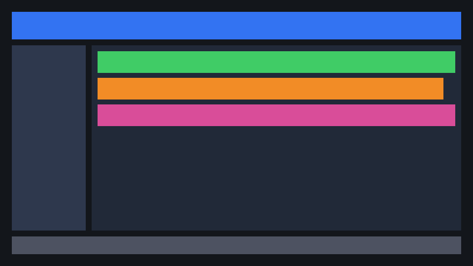
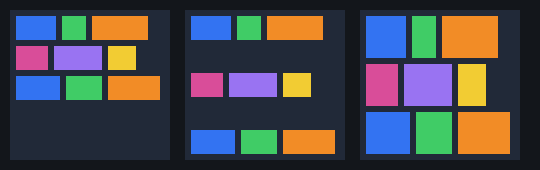
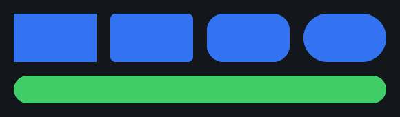
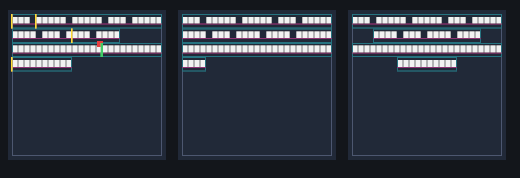

# SpriteUI

**Versão CMake:** 0.6.0 — núcleo C++20 (layout, input, widgets, docking, texto, config). A versão ainda não implica uma release publicada. Estado atual: `docs/IMPLEMENTATION_STATUS.md`; checklist de release: `docs/RELEASE_CHECKLIST.md`.

SpriteUI é o início executável de uma biblioteca de interface 2D orientada a dados. O núcleo matemático, input, widgets lógicos, animação e extração de comandos são independentes de ECS e de API gráfica, para que Flecs e Diligent possam ser integrados por adaptadores sem contaminar os contratos públicos.

> Importante: esta entrega ainda não é uma GUI com janela visível. O backend incluído é `NullRenderBackend`, usado para validar pacotes e o fluxo CPU. O shader compila para DXIL, mas backend Diligent, integração Flecs, submissão a GPU real e shaping de fontes de produção ainda são etapas futuras.

## Funcionalidades implementadas

- ABI `SpriteInstanceGPU` com 80 bytes, alinhamento 16 e verificações de layout/offset em compilação.
- Conversão de cor sRGB → linear e premultiplicação de alpha.
- Canvas Screen/World e modo Unlit/ClusterLit com validação das combinações permitidas.
- Anchors/offsets e transformação 2D com pivô, escala e rotação.
- Transformação local em pixels para hit-testing coerente com o tamanho lógico do widget.
- Handles com índice + geração para evitar referências recicladas.
- Roteamento de input com hover, foco, captura, click, wheel, move e cancelamento por perda de foco.
- Propagação de eventos pelos ancestrais (`HitTarget::parent`) e consumo de input por alvo/ancestral.
- Navegação espacial por teclado/gamepad e eventos semânticos `Activate`/`Cancel`.
- Slider com clamp, domínio, passo opcional e proteção contra largura zero.
- ScrollView com limites `contentSize - viewportSize`.
- ToonMotion básico com easing, `Override`/`Queue`/`Ignore`, pausa/cancelamento e shake sem drift.
- Flags de invalidação por subsistema.
- Extração de instâncias, ordenação visual e batching apenas entre comandos consecutivos compatíveis.
- Árvore de layout com relações explícitas, remoção recursiva segura e validação de parent handles.
- Alinhamento transversal de itens (Stretch/Start/Center/End).
- Flex wrap, alinhamento de conteúdo e alinhamento por baseline em linhas.
- Quebra de texto por palavra no subconjunto implementado, incluindo regras para espaços, hífen, ZWSP, NBSP, CJK e clusters.
- Nine-Slice e referência CPU para painéis SDF arredondados.
- Interseção de clipping hierárquico para renderização e clip bounds em hit-testing.
- Validação estrutural de `FramePacket` antes da submissão.
- Shader HLSL de referência alinhado à ABI.
- `NullRenderBackend`, exemplo CLI e testes automatizados.

## Ainda não implementado

| Módulo | Estado |
|---|---|
| Flexbox | Wrap, `alignContent`, baseline, `justifyContent` e grow/shrink com limites implementados; não cobre toda a especificação CSS |
| Flecs ECS adapter | Pendente |
| Diligent Engine backend, buffers reais e fences | Pendente |
| SDL3 | Adaptador opcional de mouse/foco implementado; janela, clipboard, IME e input multi-pointer pendentes |
| GLFW | Pendente |
| Widgets visuais (desenho), drag & drop de docking | Pendente (lógica de widgets, janelas, abas e dock tree implementada) |
| HarfBuzz, FreeType e atlas MSDF de produção | Pendente (layout geométrico, caret e quebra de linha por palavra no subconjunto implementado) |
| ToonMotion timeline/keyframes e integração ECS | Pendente |
| KTX2/Basis, streaming e eviction por fences | Pendente |
| Light Prism ClusterLit, Bloom, Acrylic Blur e sombras | Pendente |
| Partículas e nodes de editor | Pendente |
| QuickJS sandbox e FFI | Pendente |

O estado completo e os limites verificados estão em `docs/IMPLEMENTATION_STATUS.md`. Os documentos de arquitetura descrevem também funcionalidades planejadas; consulte neles as seções de estado antes de tratar uma integração como concluída.

## Início rápido

Exemplo mínimo de extração e validação de um pacote de renderização, sem janela nem GPU:

```cpp
#include <SpriteUi/SpriteUi.hpp>

#include <vector>

int main() {
    using namespace ToolEngine::SpriteUi;

    Rendering::UIRenderItem item;
    item.handle = {1, 1};
    item.layout.resolvedPosition = {20.0f, 20.0f};
    item.layout.resolvedSize = {160.0f, 40.0f};

    Rendering::RenderExtractor extractor;
    const std::vector<Rendering::UIRenderItem> items{item};
    const auto packet = extractor.Build(1, items);

    Rendering::NullRenderBackend backend;
    return backend.Submit(packet) ? 0 : 1;
}
```

O exemplo não cria nem desenha uma janela. Para compilar um consumidor instalado, veja o teste `tests/package_consumer` e as instruções de build abaixo.

### Adaptador opcional SDL3

O adaptador conecta eventos SDL3 de mouse/foco ao `UIInputSnapshot`; ele não cria janelas nem escolhe uma API gráfica. O core continua sem dependências SDL3.

```sh
cmake -S . -B build-sdl -DSPRITEUI_BUILD_SDL3_ADAPTER=ON
cmake --build build-sdl --parallel
```

É necessário SDL **3.2+** instalado com o pacote CMake `SDL3`. Depois de inicializar SDL e criar uma janela, encaminhe cada evento recebido e consuma um snapshot por frame:

```cpp
Platform::SDL3InputAdapter platformInput(window);
SDL_Event event;
while (SDL_PollEvent(&event)) {
    platformInput.ProcessEvent(event);
}
const auto snapshot = platformInput.BuildSnapshot(frameId);
const auto uiEvents = eventRouter.Process(snapshot, hitTargets);
```

O adaptador deve ser criado e usado na thread principal de SDL, a janela deve permanecer viva enquanto ele for usado, e eventos de outras janelas são ignorados. O target de integração é `SpriteUi::SDL3Input`; para usá-lo, inclua `<SDL3/SDL.h>` antes ou depois do header umbrella e faça `find_package(SDL3 3.2 CONFIG REQUIRED)`.

## Capturas de referência

Estas imagens são produzidas pelo backend de software dos testes e documentam resultados CPU; não são capturas de uma GPU ou backend de produção.

| Menu e composição | Texto e layout flexível |
|---|---|
|  |  |
|  |  |

Mais imagens de clipping, baseline, Nine-Slice e ordem de pintura estão em [`docs/img/`](docs/img/).

## Requisitos

- CMake 3.21+
- Compilador C++20 (MSVC 2022, GCC 12+ ou Clang 15+ recomendado)
- Ninja opcional (recomendado)
- DXC opcional para compilar o shader de referência

O núcleo CPU não requer dependências externas.

## Compilar e testar

Windows: execute `scripts\build.bat` (usa Ninja se disponível; caso contrário, usa o gerador padrão do CMake).

Linux/macOS:

```sh
chmod +x scripts/build.sh
./scripts/build.sh
```

Manual:

```sh
cmake -S . -B build -DCMAKE_BUILD_TYPE=Debug
cmake --build build --parallel
ctest --test-dir build --output-on-failure
```

O CTest também instala o pacote num diretório temporário e compila um consumidor separado
com `find_package(SpriteUI CONFIG REQUIRED)`.

Build Release:

```sh
cmake -S . -B build-release -DCMAKE_BUILD_TYPE=Release
cmake --build build-release --parallel
ctest --test-dir build-release --output-on-failure
```

Benchmarks CPU opcionais (informativos, sem limites de aprovação):

```sh
cmake -S . -B build-bench -DSPRITEUI_BUILD_TESTS=OFF -DSPRITEUI_BUILD_BENCHMARKS=ON
cmake --build build-bench --target spriteui_benchmarks --parallel
./build-bench/spriteui_benchmarks
```

## Executar o exemplo

```sh
./build/spriteui_hello
```

No Windows: `build\spriteui_hello.exe` ou `build\spriteui_interaction_demo.exe`.

O exemplo `spriteui_hello` monta três elementos, extrai instâncias, cria batches e imprime estatísticas. O exemplo `spriteui_interaction_demo` demonstra hit-testing com rotação, foco/captura, bubbling, navegação semântica, slider e scroll. Nenhum dos dois abre janela nem envia comandos para uma GPU real.

## Exemplo de hit target transformado

`BuildHitTestTransform` produz a transformação de coordenadas locais em pixels para coordenadas lógicas de ecrã. `localSize` deve conter o tamanho em pixels lógicos:

```cpp
UILayoutRect layout{{120.0f, 80.0f}, {240.0f, 64.0f}, true, false};
UIRectTransform transform;
transform.pivot = {0.5f, 0.5f};
transform.rotationRadians = 0.15f;
transform.scale = {1.0f, 1.0f};

auto localToScreen = BuildHitTestTransform(layout, transform);
if (localToScreen) {
    Input::HitTarget target;
    target.handle = {42, 1};
    target.localToScreen = *localToScreen;
    target.localSize = layout.resolvedSize;
    target.focusable = true;
}
```

## Integração pretendida com uma engine

1. O ECS (por exemplo, Flecs) mantém componentes e entidades persistentes.
2. Um adaptador gera `UIRenderItem` e `HitTarget` a partir dos componentes alterados.
3. O núcleo SpriteUI processa input, navegação, animação e extração.
4. `RenderExtractor` cria um `FramePacket` ordenado; o validador garante que batches cobrem as instâncias sem lacunas/overlaps.
5. Um backend Diligent futuro consome o `FramePacket`, mantém buffers/ring e não recicla memória GPU antes das fences.
6. Light Prism é consultada apenas para Canvas `World` com `ClusterLit`; HUD Screen é `Unlit` por padrão.

Não armazene ponteiros da RHI nos componentes ECS. Utilize handles com geração e um registry no backend.

## Contrato de alpha

- Cor de albedo/textura deve ser amostrada em espaço linear (ou formato SRGB com decodificação correta).
- `SpriteInstanceGPU::tint` é RGBA linear pré-multiplicado.
- O blending Source-Over esperado usa `ONE / INV_SRC_ALPHA` para cor. O backend deve definir e validar o estado completo de blending para a API escolhida.
- Texturas de dados (normal, máscara, roughness) não devem sofrer decodificação sRGB.

## ABI `SpriteInstanceGPU` — 80 bytes

| Offset | Campo | Bytes |
|---:|---|---:|
| 0 | `transformRow0` | 16 |
| 16 | `transformRow1` | 16 |
| 32 | `uvRect` | 16 |
| 48 | `tint` | 16 |
| 64 | `resourceIds` | 16 |
| | **Total** | **80** |

## Licença

MIT. Dependências externas a integrar no futuro mantêm as respetivas licenças.

## Contribuição e segurança

Consulte [CONTRIBUTING.md](CONTRIBUTING.md), [SECURITY.md](SECURITY.md) e [docs/THREAD_SAFETY.md](docs/THREAD_SAFETY.md).

## Layout Core (incremental)

`SpriteUi/Layout/Layout.hpp` fornece `LayoutEngine` com fases `Measure` e `Arrange`, direção Row/Column, tamanho Fixed/Percent/Auto/Flex, grow/shrink, gap, padding, margins e limites min/max. `LayoutTree` permite compor uma árvore com `UIHandle` sem dependência de ECS.

```cpp
using namespace ToolEngine::SpriteUi;
LayoutTree tree;
FlexItem rootStyle; rootStyle.direction = LayoutDirection::Column;
rootStyle.width = {SizeMode::Fixed, 640};
rootStyle.height = {SizeMode::Fixed, 480};
auto root = tree.Create({}, rootStyle);
FlexItem child; child.width = {SizeMode::Flex, 0}; child.height = {SizeMode::Fixed, 40};
child.grow = 1.0f;
tree.Create(root, child);
tree.Layout({{0,0},{640,480}});
```

Este é um subconjunto de Flex: há freeze/re-distribuição para limites, wrap, `justifyContent`, `alignContent` e baseline; não há implementação de todas as regras CSS nem bases intrínsecas complexas. `BuildClipHierarchy` recebe clips em ordem pai-antes-do-filho e retorna interseções efetivas; o índice resultante pode ser atribuído a `UIRenderItem::clipIndex`. Para input, `HitTarget::clipRectLogical` deve receber o clip efetivo em coordenadas lógicas. Veja `docs/IMPLEMENTATION_STATUS.md` para limites e próximos passos.
